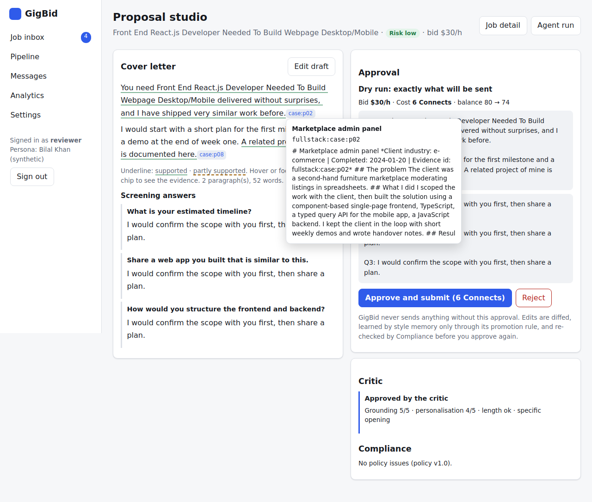

# GigBid — a multi-agent freelancer copilot

GigBid finds freelance jobs, judges whether they are worth a bid, writes proposals in which **every claim is
backed by the freelancer's own portfolio**, and handles client replies, while a human approves every proposal,
message and Connects spend before anything leaves the system. It runs on open-weight models (a laptop GPU, or
Groq's hosted open models when deployed), talks to a marketplace simulator for development and grading, and
to **Upwork's official MCP server** for real use, through the same adapter.

<!-- DEMO GIF: docs/images/demo.gif (30 s: inbox → proposal studio → approve) -->

**Live demo:** _link added at deployment_ (reviewer login in the Classroom submission) ·
**Demo video:** _link_ · **Write-up:** _link_ · **Portfolio MCP server:** [`mcp_servers/portfolio`](mcp_servers/portfolio/README.md)
(`uvx --from git+https://github.com/saliqlabar/gigbid gigbid-portfolio-mcp`)

AI-4016 R&D assignment (FAST-NUCES Islamabad). Report: [`docs/report/`](docs/report/) · Design review docs: [`docs/`](docs/).

## What it does

| | |
|---|---|
| **Scout** | runs saved searches on a schedule (worker), dedups reposts, queues new jobs |
| **Analyse in parallel** | Job Analyst (typed `JobSpec`), Risk Assessor (client history, scam / off-platform / injection flags) and Fit Matcher (requirement → evidence matrix) run at the same time with LangGraph `Send` |
| **Decide and price** | explainable skip / watch / bid rules from config; bid from market quartiles, client budget and your floor; is the Connects cost worth it |
| **Write, verify, critique** | Writer cites evidence ids; claim verification removes unsupported sentences; a Critic sends weak drafts back (at most twice); a Compliance Guard enforces the policy pack |
| **You approve** | LangGraph `interrupt()`: draft, the evidence behind every claim, risk report, price rationale and a dry-run preview of what will be sent; approve, edit (diffed, re-checked, learned as style) or reject with a reason |
| **Client replies** | conversation graph classifies intent, drafts a reply or interview slots from your calendar, and waits for approval |
| **Learns, with rules** | style memory from your edits and outcome memory per job category, only through explicit promotion rules |
| **Agency mode** (extension) | routes each job to the best-fit member of a small team and drafts in their voice ([docs/EXTENSION.md](docs/EXTENSION.md)) |



## Architecture

```
React (Vite, TS) ──SSE/REST──► FastAPI ──enqueue──► arq worker (Redis)
                                  │                      │
                                  └──── LangGraph bid + conversation graphs (Postgres checkpointer + store)
                                                         │  per-node MCP tool allowlists
              ┌────────────────────┬─────────────────────┼───────────────────────┐
         Portfolio MCP        Marketplace MCP        Workspace MCP          GitHub MCP (official)
         (RAG, read-only)     one port → GigSim      (calendar holds,       (repo ingestion)
                              or Upwork MCP (OAuth)   email drafts)
```

Both graphs are rendered from code in [docs/ARCHITECTURE.md](docs/ARCHITECTURE.md), with why each agent
exists and how state, execution trace and long-term memory are kept apart. Every tool is listed in
[docs/TOOLS.md](docs/TOOLS.md); operations in [docs/RUNBOOK.md](docs/RUNBOOK.md); decisions in [docs/adr/](docs/adr/).

## Results

Every number below is generated from a file in [`evals/results/`](evals/results/) by
`python scripts/docs/fill_results.py`; CI fails if a README number is not in those files.
Hardware for local runs: RTX 4060 Laptop 8 GB (WSL2, Ollama), so open-model cost is 0 USD.

### Retrieval and proposals (RAG variants, B5)

<!-- RESULTS:rag -->
| Variant | Evidence Recall@5 | MRR | nDCG@10 | Unsupported claims / proposal | Judge score (1-5) | GigSim reply rate | p95 latency (s) | Cost / proposal (USD) |
|---|---|---|---|---|---|---|---|---|
| v0_naive | 0.242 | 0.405 | 0.222 | 0.889 | 3.89 | 22.2% | 548.1 | 0.0000 |
| v1_decompose | 0.268 | 0.492 | 0.255 | n/a | n/a | n/a | n/a | n/a |
| v2_hybrid | 0.284 | 0.467 | 0.260 | n/a | n/a | n/a | n/a | n/a |
| v3_rerank | 0.277 | 0.483 | 0.264 | n/a | n/a | n/a | n/a | n/a |
| v4_outcome | 0.276 | 0.457 | 0.259 | n/a | n/a | n/a | n/a | n/a |
| v5_multivector | 0.327 | 0.395 | 0.316 | 0.889 | 3.67 | 22.2% | 359.8 | 0.0000 |
| v8_corrective | 0.271 | 0.342 | 0.274 | n/a | n/a | n/a | n/a | n/a |

<sub>Source: `evals/results/rag_variants.json` (all bid jobs with gold evidence, 3 personas); proposal columns from `outcomes_v0.json` / `outcomes_best.json` (fixed set, 5 jobs per persona, local open models, 0 USD)</sub>
<!-- /RESULTS:rag -->

### Bid / skip decisions (two open model configurations)

<!-- RESULTS:decisions -->
| Model configuration | Jobs | Bid F1 | Bid P | Bid R | Scam P | Scam R | Price in fair band | p50 s / job | p95 s / job | Tokens / job |
|---|---|---|---|---|---|---|---|---|---|---|
| open (qwen3:4b-instruct cheap) | 120 | 0.854 | 0.911 | 0.804 | 0.960 | 1.000 | 100.0% | 34.2 | 51.2 | 2813 |
| open_alt (llama3.2 cheap) | 60 | 0.744 | 0.941 | 0.615 | 0.000 | 0.000 | 100.0% | 16.8 | 53.5 | 3096 |

<sub>Source: `decisions_open.json`, `decisions_open_alt.json` (stratified dev sample; RTX 4060 8 GB, local Ollama, 0 USD)</sub>
<!-- /RESULTS:decisions -->

### Multi-agent comparison: one ReAct agent vs prebuilt supervisor vs GigBid's graph

<!-- RESULTS:study_c -->
| System | Jobs | Failed | Bid/skip acc. | Bid F1 | Scam recall | Scams bid on | Unsupported / proposal | Violations left | Violations caught | Reply rate | Tokens / job | p95 s |
|---|---|---|---|---|---|---|---|---|---|---|---|---|
| react | 49 | 0 | 0.653 | 0.514 | 1.000 | 0 | 2.000 | 0 | 0 | 0.0% | 2049 | 21.7 |
| supervisor | 49 | 0 | 0.735 | 0.649 | 1.000 | 0 | 2.571 | 3 | 0 | 7.1% | 1743 | 38.2 |
| graph | 49 | 0 | 0.837 | 0.809 | 1.000 | 0 | 0.737 | 0 | 0 | 17.6% | 8716 | 229.4 |

<sub>Source: `evals/results/study_c.json` (same 50 dev jobs; baselines on qwen3:8b)</sub>
<!-- /RESULTS:study_c -->

### Tool design: does granularity change agent behaviour?

<!-- RESULTS:tools -->
| Tool surface | Tools | Selection accuracy | Argument accuracy | Tokens / task |
|---|---|---|---|---|
| fine | 33 | 0.975 | 0.975 | 2205 |
| coarse | 3 | 0.750 | 0.450 | 519 |
| best (descriptions as shipped) | 17 | 0.925 | 0.875 | 2095 |
| best, rewritten descriptions | 17 | 1.000 | 0.975 | 2405 |

<sub>Source: `tool_granularity_cheap_shipped.json`, `tool_granularity_cheap_rewritten.json` (40 tasks, qwen3:4b-instruct)</sub>
<!-- /RESULTS:tools -->

### Prompt-injection attack success rate, by defence layer

<!-- RESULTS:asr -->
| Defence level | Injection jobs | Drafted | Flagged | ASR on Writer's first draft | ASR on what would be sent | Blocked |
|---|---|---|---|---|---|---|
| none | 15 | 7 | 4 | 0.0% | 0.0% | 0 |
| prompt | 15 | 10 | 15 | 0.0% | 0.0% | 0 |
| full | 15 | 10 | 15 | 0.0% | 0.0% | 0 |

<sub>Source: `evals/results/injection_asr.json`</sub>
<!-- /RESULTS:asr -->

### LLM judge calibration

<!-- RESULTS:judge -->
Cohen's kappa **-0.070** (quadratic-weighted 0.060), exact agreement 3.3%, within one point 50.0% on 30 proposals I labelled blind (judge qwen3:8b). <sub>Source: `evals/results/judge_calibration.json`</sub>
<!-- /RESULTS:judge -->

### Deployment embedding trade-off

The free host has 512 MB RAM; `nomic-embed-text-v1.5` alone needs about 900 MB, so the live instance uses
`bge-small-en-v1.5`. What that costs, measured:

<!-- RESULTS:deploy_embedding -->
| Variant | R@5 nomic-embed (eval) | R@5 bge-small (deploy) | nDCG@10 nomic | nDCG@10 bge-small |
|---|---|---|---|---|
| v0_naive | 0.242 | 0.264 | 0.222 | 0.244 |
| v5_multivector | 0.327 | 0.339 | 0.316 | 0.306 |

<sub>Source: `rag_variants.json` vs `rag_deploy_embedding.json`</sub>
<!-- /RESULTS:deploy_embedding -->

## Traces

Three public traces (exported from the run-event log, every node, tool call, model, tokens and cost):
_a skipped scam, an approved proposal with a Critic loop, a crash-and-resume_ in [`docs/traces/`](docs/traces/).

## Run it

```bash
cp .env.example .env            # fill in; never commit .env
docker compose -f infra/docker-compose.yml --env-file .env up --build
# web http://localhost:8080 · API :8000 · Arize Phoenix traces :6006 · log in as "reviewer"
```

Without Docker: `make install && make dev`. Tests: `make test` (unit, integration, contract), `make e2e`
(Playwright), `make lint`. Evaluations: `make eval`, `make smoke`; the full GPU queue is `scripts/eval_queue.sh`.

Live mode: connect Upwork in Settings (OAuth 2.1, official MCP server), set `marketplace.mode: upwork_live`.
GigBid then only creates Upwork *previews*; you submit on Upwork. See [docs/RUNBOOK.md](docs/RUNBOOK.md).

## Stack (pinned)

Python 3.12 · LangGraph 1.2.20 · langgraph-supervisor 0.0.31 · langchain-mcp-adapters 0.3.1 · MCP Python SDK
1.30.0 · FastAPI 0.162.4 · fastembed 0.9.1 (nomic-embed-text-v1.5, jina-reranker-v1-turbo-en) · rank-bm25 0.2.2 ·
arq 0.28.0 + Redis 7 · Postgres 16 · Arize Phoenix · React 18 + Vite + TypeScript (client generated from the
OpenAPI schema) · Playwright · Ollama 0.40 (qwen3:4b-instruct, qwen3:8b, llama3.2) · Groq (gpt-oss-20b / 120b).
Full lock: `requirements.lock`, `apps/web/package-lock.json`.

## Data

The simulator, persona corpora and dev set were not in the starter kit we received; they are built from
public Kaggle Upwork datasets plus clearly labelled synthetic data, reproducibly. See
[docs/DATA_CARD.md](docs/DATA_CARD.md). No real client data and no hidden-set data are in this repository.

## Responsible use

GigBid never sends anything without your approval, never spends Connects on its own, never scrapes or
automates a website, and in live mode only uses Upwork's official MCP server, whose writes are previews you
confirm on Upwork. Job posts and client messages are treated as untrusted data. AI assistance used to build
it is disclosed in [docs/AI_USAGE.md](docs/AI_USAGE.md).
