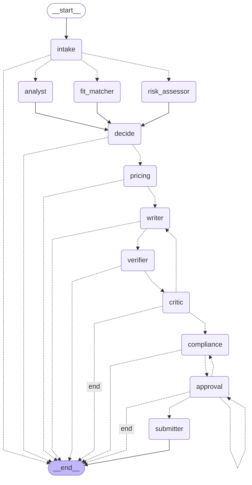
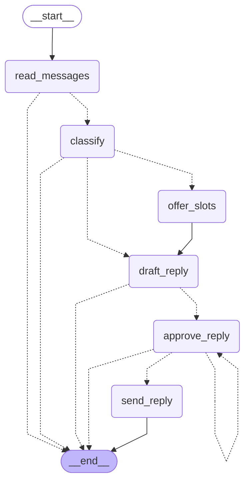

# Architecture

GigBid is two LangGraph graphs behind a FastAPI API and a React UI. Agents reach the outside world only
through MCP tools, and the marketplace only through one port (`agent/marketplace_port.py`) with two
adapters (GigSim, live Upwork) chosen in `agent/config.yaml → marketplace.mode`.

```
React (Vite, TS)  --SSE/REST-->  FastAPI (apps/api)  --enqueue-->  arq worker (Redis)
                                        |                               |
                                        +-------- LangGraph graphs -----+
                                                  |  Postgres checkpointer + store
                                                  v
                           MCP client (agent/mcp_client.py, per-node allowlists)
                 +-----------------+--------------------+----------------------+
                 v                 v                    v                      v
          Portfolio MCP     Marketplace MCP       Workspace MCP        GitHub MCP (3rd party)
          (RAG, read)       (port -> GigSim |     (calendar holds,     (repo ingestion)
                             Upwork MCP)           email drafts)
```

## Bid graph (one thread per job)

Rendered from code (`build_bid_graph().get_graph().draw_mermaid()`; source in `docs/images/bid_graph.mmd`).
Job Analyst, Risk Assessor and Fit Matcher are launched together with `Send` from `intake` and join at
`decide`; parallel writes go through reducers in `agent/state.py`.



## Conversation graph (one thread per client conversation)



## Why each agent exists

| Agent (node) | Why it is a separate step | Model tier | MCP access |
|---|---|---|---|
| Scout (`scout`, worker) | runs saved searches on a schedule, dedups, queues; no LLM needed for most jobs | cheap | marketplace read |
| Job Analyst (`analyst`) | turns an untrusted post into a typed `JobSpec`; everything downstream decides on fields, not prose | cheap | none |
| Risk Assessor (`risk_assessor`) | client history + scam / off-platform / injection flags; must be able to veto a bid on its own | cheap | `get_client_history` |
| Fit Matcher (`fit_matcher`) | requirement-to-evidence matrix and fit score; it is the retrieval step R6 measures | cheap | `search_evidence` |
| Decision (`decide`) | deterministic rules over the three reports (thresholds in config), so a skip is explainable | none | none |
| Pricing Strategist (`pricing`) | bid from market quartiles, client spend and the user's floor; Connects expected value | cheap | `get_market_stats`, `get_connects_balance` |
| Proposal Writer (`writer`) | the only free-text generator; strongest model | strong | `search_evidence`, `get_evidence` |
| Claim verification (`verifier`) | splits the draft into claims and drops unsupported ones before the Critic (B3, R5) | cheap | `get_evidence` |
| Critic (`critic`) | grounding, personalisation, length; sends back at most twice | strong | `get_evidence` |
| Compliance Guard (`compliance`) | policy pack as data (`data/policy_pack/rules.yaml`); redacts or blocks | none (rules) | none |
| Approval (`approval`) | `interrupt()` with draft, evidence per claim, risk, price rationale, dry-run preview | none | `create_proposal_draft` (dry run) |
| Submitter (`submitter`) | idempotent draft + submit after approval only | none | `create_proposal_draft`, `submit_proposal` |
| Client Liaison (conversation graph) | intent classification, reply drafting, interview slots; approval before sending | strong | messages, workspace |

Whether this split is worth it is R&D question C (`evals/results/study_c.json`).

## State, trace and memory are kept apart

* **State** (`agent/state.py`): typed `BidState` / `ConversationState`, separate fields for job, analyses,
  evidence, decision, price, drafts, critiques, approvals and outcome; reducers wherever parallel branches
  write. Checkpointed in Postgres (`agent/persistence.py`; SQLite locally).
* **Execution trace**: every tool name, argument, result and LLM call goes to the run-event log
  (`agent/trace.py`, streamed to the run viewer) and to Arize Phoenix via OpenTelemetry
  (`agent/observability.py`), with one trace id shared by the UI request, API, graph, MCP servers and the
  marketplace audit log. PII is masked before anything is written.
* **Long-term memory** (`agent/memory/`): a LangGraph store with two namespaces, `("style", user)` and
  `("outcome", user, category)`. Observations (one per user edit, one per outcome) are stored raw in the
  app DB; only `agent/memory/promotion_rules.py` can write to the store, and only when a signal repeats
  (style: in ≥3 of the last 5 edits; outcome: ≥3 outcomes in a category). Raw tool output never enters it.

## Hand-offs

Agents exchange Pydantic objects (`agent/handoffs.py`): `JobSpec`, `RiskReport`, `FitReport`,
`BidDecision`, `PriceQuote`, `ProposalDraft`, `Critique`, `ComplianceVerdict`, `ApprovalDecision`.

## Limits and failure handling

* Critic loop ≤ `budgets.max_revisions` (2); step budget `max_graph_steps` and token budget
  `max_tokens_per_job` per thread; exceeding either moves the thread to `needs_attention`.
* Per-node retries and timeouts (`nodes:` in config), a fallback model for cheap nodes, a `dead_letter`
  status for jobs that cannot complete, bounded retries with backoff on MCP calls, and a `degraded` status
  plus UI banner when the marketplace MCP server is unreachable (work is queued and resumed by the worker).
* Durability: approvals resume the checkpointed thread; submission uses idempotency keys, so a crash
  between approval and submit still submits exactly once (`tests/integration/test_bid_graph.py::test_crash_and_resume_submits_exactly_once`).
